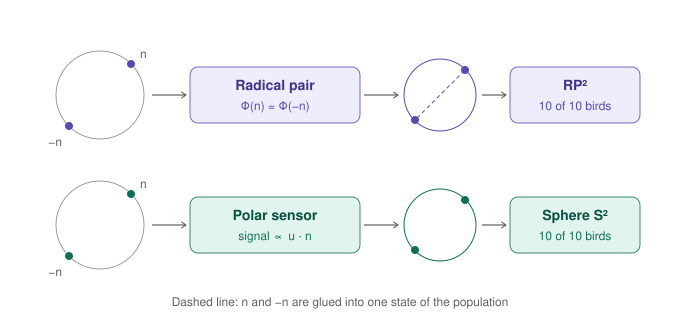
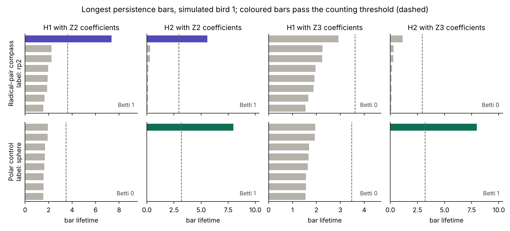
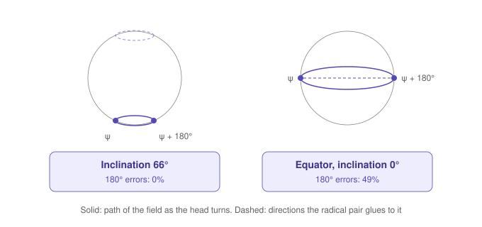

# MAG-S2: the shape of the quantum compass signal

A pre-registered simulation study of what the joint activity of neurons looks like when they read a radical-pair (cryptochrome) magnetic compass. It predicts that the population lies on the real projective plane RP², while a polarity-sensitive compass read by the same eyes and neurons gives a sphere S². The two shapes can be told apart in population recordings taken while three-axis coils rotate the field, without knowing what each neuron encodes.

Author: Julia Ryzhkova (Siriona, siriona.one; ORCID 0009-0005-4194-6059).
Status: version 0.1 complete, 7 November 2026. The protocol, code, physics and thresholds were frozen before the confirmatory run, and the run with its verdicts is included.



## The prediction

A radical pair responds in the same way to a field n and to the reversed field −n: its singlet yield is an even function of the field direction, Φ(n) = Φ(−n). Every cryptochrome signal, and every neuron that sums such signals, is therefore an even function of n as well. The population then has one state for each axis of the field, and its states form a sphere with opposite points glued together, the real projective plane RP². A sensor that feels polarity, such as a response proportional to the projection of the field on the receptor axis, keeps n and −n apart and gives a sphere.

Persistent homology separates the two shapes. With Z₂ coefficients RP² has one loop and one cavity (Betti numbers b₁ = 1, b₂ = 1), and with Z₃ coefficients both vanish. A sphere has one cavity under both fields. The pipeline reads orientability from the longest H₂ bar, which keeps its length under Z₃ only on an orientable surface.

Four hypotheses were registered:

- **H1.** With the intact compass and three-dimensional field rotations, the population is labelled RP² in at least 8 of 10 simulated birds.
- **H2.** The polar control, read by the same eyes and neurons, is labelled a sphere in at least 8 of 10.
- **H3.** Head rotations about the vertical axis alone (yaw) give a ring in at least 8 of 10, both at inclination 66° and at the magnetic equator.
- **H4.** A nearest-neighbour heading decoder confuses headings ψ and ψ + 180° at the equator (lower bound of the 95% interval of the share of errors larger than 90° at least 0.40) and keeps them apart at inclination 66° (upper bound at most 0.05).

A shape hypothesis is testable only when the pipeline recognises that shape in the atlas of known shapes drawn in the same run, in at least 8 of 10 birds. For H3 the gate is a pair of atlas rings whose neurons carry the noise share of the two yaw conditions.

## Results of the confirmatory run

The confirmatory run used seeds 1–10 (ten simulated birds, each with its own retina, neurons, field directions and noise). It ran on 7 November 2026 and took 13.5 minutes on two cores. The frozen analysis found the run valid and confirmatory: the hashes of code, analysis and physics matched, BLAS ran on one thread, and every invariant held. All three expectations and all four hypotheses were met.

| Check | Verdict | Result |
|---|---|---|
| I1–I5, invariants | ok | difference between populations for n and −n at most 5.1·10⁻¹⁴; the exact yield matches a time-domain propagation on RadicalPy's propagator to 2.0·10⁻⁸ and a resolvent solution to 8.4·10⁻¹⁵; noise above the frequency bound leaves the population identical to the intact compass in every bird; all records complete and finite |
| Q1, atlas | met | point, ring, sphere, torus and RP² recognised in 10 of 10 birds, Klein bottle in 8 |
| Q2, the compass works | met | relative anisotropy of the singlet yield 20.8% |
| Q3, the fit | met | spherical-harmonic fit within 0.24% of the yield SD at 400 directions outside the fit grid |
| H1 | met | intact compass labelled RP² in 10 of 10 birds |
| H2 | met | polar control labelled sphere in 10 of 10 |
| H3 | met | yaw rotations labelled ring in 10 of 10 at 66° and at the equator; both gate rings recognised in 10 of 10 |
| H4 | met | share of errors larger than 90° equals 0.493 [0.473; 0.512] at the equator and 0 in every bird at 66° |

In every bird the intact compass gave exactly the Betti numbers of RP²: (1, 1) with Z₂ and (0, 0) with Z₃. The ratio of the longest H₂ bars under Z₃ and Z₂ lay between 0.18 and 0.35, against an orientability threshold of 0.9. The polar control gave a sphere in every bird, with a cavity under both fields and a ratio of 1.0. The retina and the neurons are the same in both conditions, so the difference in shape comes from whether the receptor feels the polarity of the field.



Under yaw rotations the field traces one circle on the sphere of directions, and the population gives a ring for any compass. At inclination 66° the headings ψ and ψ + 180° stay different states. At the equator they are opposite field directions, the radical pair glues them, and the decoder chooses between them at random.



### Exploratory results

**E1, radio-frequency dose.** The disruption compresses the yield pattern towards its mean by a factor 1 − d, while the noise of each neuron stays unchanged.

| d | Labels of the compass over 10 birds |
|---|---|
| 0 | RP² in 10 |
| 0.25 | RP² in 10 |
| 0.5 | RP² in 7, other in 3 |
| 0.75 | point in 10 |
| 1 | point in 10 |

**E2, requirements map.** Each cell gives the number of birds out of 10 with the correct label: RP² for the radical-pair compass, then sphere for the polar control. Noise 0.5 corresponds to a single-neuron signal-to-noise ratio of 2.

| Neurons | Noise 0.25 | Noise 0.5 | Noise 1 |
|---|---|---|---|
| 25 | 6 / 10 | 0 / 9 | 0 / 0 |
| 50 | 10 / 10 | 10 / 10 | 0 / 5 |
| 100 | 10 / 10 | 10 / 10 | 5 / 10 |

RP² needs more neurons and less noise than the sphere. At a single-neuron signal-to-noise ratio of 2, fifty neurons suffice. With 25 neurons the pipeline finds RP² only at noise 0.25, in 6 of 10 birds, while it still recognises the sphere at noise 0.5. When the noise equals the signal, RP² appears only with 100 neurons and only in half of the birds.

**E3, bar margins.** For the intact compass the longest H₁ and H₂ bars with Z₂ are 2.10 and 2.12 times the counting threshold (medians over the birds), and with Z₃ they reach 0.78 and 0.58 of it, as expected for a non-orientable surface.

## How to test the prediction in birds

1. Record population activity of tens of neurons or more in a brain area that carries compass information, for example Cluster N, which European robins need for magnetic compass orientation (Zapka et al. 2009).
2. Rotate a field of geomagnetic strength over many directions in the head frame with three-axis coils.
3. Run the frozen pipeline: z-score, six principal components, persistent homology with Z₂ and Z₃, the calibrated thresholds and the orientability ratio.
4. Repeat the rotations under broadband radio-frequency noise on both sides of the upper frequency bound of about 116 MHz predicted for a flavin–tryptophan radical pair: blackcaps lose magnetic orientation in noise at 75–85 MHz and keep it at 140–150 MHz (Leberecht et al. 2023). For a radical-pair compass the model predicts that strong enough noise below the bound collapses RP² to a point (E1), while noise above it leaves RP² intact.
5. As a simpler test, use a horizontal field: an axial compass makes the population confuse headings ψ and ψ + 180° (H4).

RP² by itself identifies an axial readout, and any axial sensor would produce it; some magnetite receptors are axial as well (Winklhofer & Kirschvink 2010). The frequency-selective radio-frequency control is what ties the shape to a radical pair. A sphere identifies a polarity-sensitive input. The vestibular magnetic pathway of pigeons is a natural place to look for one: its neurons are tuned to field polarity under three-axis coil rotations (Wu & Dickman 2012), and Nordmann et al. (2025) trace magnetically induced activity in the pigeon brain to the vestibular system and to electromagnetic induction, whose voltage changes sign when the field reverses. The polar control also predicts a sphere for compass neurons of animals with a polarity compass, such as mole-rats (Marhold, Wiltschko & Burda 1997). Head-direction cells of birds (Ben-Yishay et al. 2021; Takahashi et al. 2022) are another place to record.

## Related work and what is new

A search of the literature, preprint servers, research registries and public code repositories on 7 November 2026 found no work that predicts or measures the topology of neural population activity carrying the direction of the magnetic field, and no work that applies persistent homology or the projective plane to magnetoreception. A recent review describes the neural circuits that process magnetic information as incompletely understood (Shirdhankar & Malkemper 2024), and a guide to recording magnetically driven neural activity sets out the controls such experiments need (Fenton, Nath & Malkemper 2022). The parts that MAG-S2 combines are established separately.

- **Axial and polar sensing.** Birds use an inclination compass that responds to the axis of the field lines and their angle with the vertical (Wiltschko & Wiltschko 1972). In a horizontal field their orientation becomes bimodal (Wiltschko & Wiltschko 1996) or random (Schwarze et al. 2016); H4 is the population-level form of this behavioural ambiguity. Neural responses have already served to separate axial from polar sensing: pigeon vestibular neurons are tuned to field polarity (Wu & Dickman 2012), and human EEG responses depend on the polarity of the vertical field component, which the authors take as evidence against a radical pair (Wang et al. 2019).
- **Radical pairs in the eye.** Models of cryptochrome in the retina describe the pattern the field casts on the eye (Ritz, Adem & Schulten 2000) and how precisely the field direction can be read from it (Solov'yov, Mouritsen & Schulten 2010; Ren, Hiscock & Hore 2021). Radio-frequency disruption of the compass was shown by Ritz et al. (2004) and Engels et al. (2014), and the upper frequency bound comes from Leberecht et al. (2023).
- **Topology of neural codes.** Persistent homology recovers a ring in the activity of head-direction cells (Chaudhuri et al. 2019) and a torus in grid cells (Gardner et al. 2022), and earlier work asked how many neurons and what firing and noise conditions such analyses need in spatial codes (Dabaghian et al. 2012; Kang, Xu & Morozov 2021). Comparing Z₂ and Z₃ coefficients to recognise the projective plane is standard in computational topology (Hatcher 2002; Perea 2018).

MAG-S2 adds the link between these parts: the prediction that the symmetry Φ(n) = Φ(−n) of the radical pair places the compass population on RP² while a polarity-sensitive input gives S², a pre-registered test of this prediction through model eyes and neurons with an atlas-gated pipeline, an orientability readout from the ratio of the longest H₂ bars under Z₃ and Z₂, and a map of the neurons and noise levels at which RP² stays recognisable.

## Model

**Radical pair.** Flavin anion with nuclei N5 and N10 and tryptophan cation with nucleus N1, anisotropic hyperfine tensors from the RadicalPy database (Hilbert space of dimension 108). The pair starts in the singlet state in a 50 µT field and recombines with rate k = 10⁶ s⁻¹ from singlet and triplet alike; exchange and dipolar couplings are zero. The singlet yield is computed exactly in the eigenbasis of the spin Hamiltonian (Timmel et al. 1998), with M = 27 nuclear spin states:

$$\Phi_S(\hat n) = \frac{1}{M}\sum_{a,b}\left|\langle a|\hat P_S|b\rangle\right|^2 \frac{k^2}{k^2+\omega_{ab}^2}$$

The yield is fitted with real spherical harmonics of all degrees up to 10 on 2000 directions that contain every direction together with its opposite; odd degrees are kept so that the fit itself could show any asymmetry. The mean yield is 0.375, it ranges from 0.346 to 0.424, and 99.997% of the anisotropic power lies in degree 2.

**Eyes.** Two lateral eyes look 60° to either side of forward, each retina covers a cap of radius 80°, with 400 receptor patches in total. The molecular z axis lies along the photoreceptor axis and the x axis along the local meridian with a 10° jitter (Ritz et al. 2000).

**Neurons.** Each of 100 neurons reads a Gaussian patch (15°) of one eye with an ON or OFF sign. The sum passes through a softplus with gain 2 and a random bias. The noise is Gaussian with SD equal to half of the neuron's signal SD under the intact compass, so a single neuron has a signal-to-noise ratio of 2.

**Polar control.** Same eyes and neurons; each receptor responds to the projection of the field on its own axis, and its noise is the same share of its own signal.

**Radio-frequency noise.** Noise at frequencies below the bound compresses the yield pattern towards its mean by a factor 1 − d, with the neurons' noise unchanged, so the signal-to-noise ratio falls. Noise above the bound leaves the pattern intact and runs on the same random numbers as the intact compass.

**Field rotations.** In the three-dimensional condition the field takes 600 random directions relative to the head, as with three-axis coils. In the yaw conditions the head turns only about the vertical axis to 600 random headings, at inclination 66° and at the magnetic equator.

## Topology pipeline and calibration

The activity of each neuron is z-scored, and the cloud of 600 points is projected on 6 principal components. Ripser (Tralie, Saul & Bar-On 2018) builds the Vietoris–Rips complex on 200 landmarks chosen by greedy subsampling and computes H₁ and H₂ bars with Z₂ and Z₃ coefficients. A bar counts when it outlives 0.4 of the longest bar of the same dataset and 4 times the longest bar of its dimension in two shuffled copies, where each neuron's activity is permuted independently. The Z₂ Betti numbers give the number of loops b₁ and cavities b₂; a surface counts as orientable when the ratio of the longest H₂ bars under Z₃ and Z₂ is 0.9 or more.

| Shape | b₁ with Z₂ | b₂ with Z₂ | Orientable |
|---|---|---|---|
| point | 0 | 0 | – |
| ring | 1 | 0 | – |
| sphere | 0 | 1 | yes |
| torus | 2 | 1 | yes |
| projective plane RP² | 1 | 1 | no |
| Klein bottle | 2 | 1 | no |

Any other combination gets the label "other". The atlas holds synthetic populations of 100 neurons with the same nonlinearity and noise as the compass: its sphere is linear in the field direction, like the polar control, and its RP² is built from quadratic forms of the direction, like the radical-pair pattern.

The two threshold factors were calibrated on the atlas alone (seeds 1001–1010), and the compass conditions first went through the classifier in the confirmatory run. The calibration took three rounds, all recorded in the protocol with their reasons. In round 1 a threshold set by the shuffled copies alone recognised at best the ring, in 8 of 10 seeds. Round 2 tied the threshold to the scale of the data and recognised five shapes in 10 of 10 seeds, and reading orientability from the ratio of the longest H₂ bars raised the Klein bottle to 8 of 10. Round 3 required 90% only for the shapes named by the hypotheses (point, ring, sphere and RP²) and chose the pair with the highest worst-case accuracy over all six shapes; this rule was set before the compass was classified for the first time. The chosen factors 0.4 and 4 recognise five shapes in 10 of 10 calibration seeds and the Klein bottle in 8. The calibration reproduces bitwise with the frozen code, and an independent reviewer repeating it on 20 fresh seeds (2001–2020) obtained the same pair.

## Checks before the confirmatory run

- **Physics.** The exact yield agrees with a step-by-step time-domain propagation that uses RadicalPy's own initial state, propagator and projection (2.0·10⁻⁸), with a resolvent solution computed directly from the Hamiltonian (8.4·10⁻¹⁵), and the Zeeman term written in angles agrees with its form in terms of the field vector (2.7·10⁻¹⁶). `physics.json` regenerates bitwise from the frozen code.
- **Analysis.** 118 synthetic checks on fabricated records with known answers; they catch all 85 deliberately inserted errors in `analyze.py` (`results/checks/mutation_testing_analyze.txt`). The tests also check that the record layout expected by the analysis equals the one the model writes.
- **Blind pipeline test.** A full run and analysis on seeds 9201–9202 with the frozen code, checked only for completeness, invariants and metadata; the outputs were deleted unseen.
- **Independent review.** A reviewer without access to the compass shapes read and tested the code, confirmed the physics, the geometry, the random streams, the atlas and the calibration, and listed points to improve. These points (validity rules and provenance checks in the analysis, completeness checks, boundary tests, noise-matched gate rings for H3, a stricter physics check, a smoke test on a non-confirmatory seed, one BLAS thread, an empty output folder for runs) were fixed and verified in a second round. The full list is in the protocol, section «Код».

## Limitations

- **Minimal radical pair.** The model has three nitrogen nuclei, with relaxation, exchange and dipolar coupling set to zero, and the anisotropy of the yield reaches 21%, while realistic models give a few percent. The shape rests on the symmetry under field reversal, which holds for any set of nuclei and any bilinear interactions; the size of the effect enters through the signal-to-noise ratio, which the model sets directly. The requirements map therefore has to be translated into numbers of neurons through the real signal-to-noise ratio of compass neurons.
- **Radio-frequency noise** is modelled as a compression of the yield pattern; a model with an oscillating field in the spin dynamics would give the dose for a given noise amplitude.
- **Eye.** The retina is two spherical caps, and the cryptochromes are ordered along the photoreceptor axis; their real orientation in the outer segments remains to be measured.
- **Neurons.** The readout is abstract; in the brain the magnetic signal mixes with vision and heading, and neurons that carry it in clean form remain to be found.
- **Full sphere of directions.** The shape appears when the field covers all directions relative to the head, which in an experiment calls for three-axis coils.
- **Polar control.** It stands for any polarity-sensitive sensor and leaves aside the physics of a particular magnetite receptor.
- **Topology from noisy data** depends on the pipeline and the thresholds, which is why the atlas gates every shape hypothesis in every run.

## Reproduce

```
pip install -r requirements.txt
cd code
python3 -I test_analyze.py                                       # 118 synthetic checks of the analysis
python3 -I mag_s2.py smoke --out OUT_SMOKE                       # technical check on seed 9307
python3 -I analyze.py ../results/confirmatory_run_v01            # recomputes results.json from the seed files, byte for byte
python3 -I mag_s2.py physics --out OUT_PHYS                      # rewrites code/physics.json with identical bytes (about 2 minutes)
python3 -I mag_s2.py calibrate --seeds 1001-1010 --out OUT_CAL   # atlas calibration (about 5 minutes)
python3 -I mag_s2.py run --seeds 1-10 --out NEW_RUN --workers 2  # the confirmatory run (about 15–20 minutes on two cores)
python3 -I ../scripts/make_figures.py 1                          # the barcode figure
```

The code sets BLAS to one thread before NumPy loads. Reruns are bitwise identical on the same BLAS build and CPU kernel; the frozen run used OpenBLAS 0.3.31 and 0.3.34 with the SkylakeX kernel, Python 3.13.18, NumPy 2.5.3, SciPy 1.18.1, RadicalPy 1.0.9 and Ripser 0.6.15. `SHA256SUMS.txt` lists every file of the release; verify with `sha256sum -c SHA256SUMS.txt`. The frozen files and the run outputs also have their own lists, `code/SHA256SUMS` and `results/SHA256SUMS`.

| File | SHA-256 |
|---|---|
| `code/mag_s2.py` | `2352aefe0fe5974732c318b365f4fb5477ffc47fb78b12748bca2515465829c4` |
| `code/analyze.py` | `d8ddb7d7fb60458f67ed8ca387b441204af44ba8c7391a56a00da851c5f5c9de` |
| `code/test_analyze.py` | `a5fabd0e3a2cac3ee0b9f72c86dc3ab117f69020c8d69a529ed5d5dd9e98197e` |
| `code/physics.json` | `647bc0ccb1312991a1b772193cac39f4ced1481c591422c50659bb822a3100c5` |
| `results/confirmatory_run_v01/results.json` | `d7ebe21465a88b272a548c0e1a179c4212490f9e7f24ea6f0715acec468b9068` |
| `protocol/MAG-S2_protocol_v0.1_ru.md` | `136f639fd28331cb917459afe27e4748767a416c215245f59c3d68f4e59fbf3e` |

## Files

- `protocol/MAG-S2_protocol_v0.1_ru.md` – the pre-registered protocol with calibration history, review, results and sources (Russian)
- `code/mag_s2.py` – physics, eyes, neurons, atlas, topology pipeline, calibration, smoke test and runs
- `code/analyze.py` – the frozen analysis: invariants, expectations, hypotheses, validity and provenance
- `code/test_analyze.py` – synthetic tests of the analysis
- `code/physics.json` – the computed yield pattern and the physics invariants
- `results/confirmatory_run_v01/` – seed files of birds 1–10, run metadata, log and `results.json`
- `results/calibration/` – the three calibration rounds and the reproduction with the frozen code
- `results/checks/` – blind pipeline test, smoke test and mutation testing of the analysis
- `scripts/make_figures.py`, `scripts/mutate_analyze.py` – the barcode figure and the mutation harness
- `figures/` – schematic figures and the barcode figure
- `requirements.txt` – package versions of the frozen run
- `SHA256SUMS.txt` – SHA-256 of every file in the release

## Licence

Code (`code/*.py`, `scripts/*.py`) is released under the MIT License. Text, figures, the protocol and the results are released under CC BY 4.0 (https://creativecommons.org/licenses/by/4.0/).

## Citation

See `CITATION.cff`.

## References

- Ben-Yishay E. et al. 2021. Directional tuning in the hippocampal formation of birds. Current Biology 31: 2592–2602.e4. https://doi.org/10.1016/j.cub.2021.04.029
- Chaudhuri R., Gerçek B., Pandey B., Peyrache A., Fiete I. 2019. The intrinsic attractor manifold and population dynamics of a canonical cognitive circuit across waking and sleep. Nature Neuroscience 22: 1512–1520. https://doi.org/10.1038/s41593-019-0460-x
- Dabaghian Y., Mémoli F., Frank L., Carlsson G. 2012. A topological paradigm for hippocampal spatial map formation using persistent homology. PLoS Computational Biology 8: e1002581. https://doi.org/10.1371/journal.pcbi.1002581
- Engels S. et al. 2014. Anthropogenic electromagnetic noise disrupts magnetic compass orientation in a migratory bird. Nature 509: 353–356. https://doi.org/10.1038/nature13290
- Fenton G. E., Nath K., Malkemper E. P. 2022. Electrophysiology and the magnetic sense: a guide to best practice. Journal of Comparative Physiology A 208: 185–195. https://doi.org/10.1007/s00359-021-01517-y
- Gardner R. J. et al. 2022. Toroidal topology of population activity in grid cells. Nature 602: 123–128. https://doi.org/10.1038/s41586-021-04268-7
- Hatcher A. 2002. Algebraic Topology. Cambridge University Press. https://pi.math.cornell.edu/~hatcher/AT/ATpage.html
- Kang L., Xu B., Morozov D. 2021. Evaluating state space discovery by persistent cohomology in the spatial representation system. Frontiers in Computational Neuroscience 15: 616748. https://doi.org/10.3389/fncom.2021.616748
- Leberecht B. et al. 2023. Upper bound for broadband radiofrequency field disruption of magnetic compass orientation in night-migratory songbirds. PNAS 120: e2301153120. https://doi.org/10.1073/pnas.2301153120
- Marhold S., Wiltschko W., Burda H. 1997. A magnetic polarity compass for direction finding in a subterranean mammal. Naturwissenschaften 84: 421–423.
- Nordmann G. C., Balay S. D., Kapuruge T. N., Numi M., Leeb C., Nimpf S., Malkemper E. P., Landler L., Keays D. A. 2025. A global screen for magnetically induced neuronal activity in the pigeon brain. Science. https://doi.org/10.1126/science.aea6425
- Perea J. A. 2018. Multiscale projective coordinates via persistent cohomology of sparse filtrations. Discrete & Computational Geometry 59: 175–225. https://doi.org/10.1007/s00454-017-9927-2
- Ren Y., Hiscock H. G., Hore P. J. 2021. Angular precision of radical pair compass magnetoreceptors. Biophysical Journal 120: 547–555.
- Ritz T., Adem S., Schulten K. 2000. A model for photoreceptor-based magnetoreception in birds. Biophysical Journal 78: 707–718. https://doi.org/10.1016/S0006-3495(00)76629-X
- Ritz T., Thalau P., Phillips J. B., Wiltschko R., Wiltschko W. 2004. Resonance effects indicate a radical-pair mechanism for avian magnetic compass. Nature 429: 177–180.
- Schwarze S. et al. 2016. Migratory blackcaps can use their magnetic compass at 5 degrees inclination, but are completely random at 0 degrees inclination. Scientific Reports 6: 33805. https://doi.org/10.1038/srep33805
- Shirdhankar R. N., Malkemper E. P. 2024. Cognitive maps and the magnetic sense in vertebrates. Current Opinion in Neurobiology 86: 102880. https://doi.org/10.1016/j.conb.2024.102880
- Solov'yov I. A., Mouritsen H., Schulten K. 2010. Acuity of a cryptochrome and vision-based magnetoreception system in birds. Biophysical Journal 99: 40–49.
- Takahashi S. et al. 2022. Head direction cells in a migratory bird prefer north. Science Advances 8: eabl6848. https://doi.org/10.1126/sciadv.abl6848
- Timmel C. R. et al. 1998. Effects of weak magnetic fields on free radical recombination reactions. Molecular Physics 95: 71–89. https://doi.org/10.1080/00268979809483134
- Tralie C., Saul N., Bar-On R. 2018. Ripser.py: a lean persistent homology library for Python. Journal of Open Source Software 3: 925. https://doi.org/10.21105/joss.00925
- Wang C. X. et al. 2019. Transduction of the geomagnetic field as evidenced from alpha-band activity in the human brain. eNeuro 6: ENEURO.0483-18.2019. https://doi.org/10.1523/ENEURO.0483-18.2019
- Wiltschko W., Wiltschko R. 1972. Magnetic compass of European robins. Science 176: 62–64.
- Wiltschko W., Wiltschko R. 1996. Magnetic orientation in birds. Journal of Experimental Biology 199: 29–38.
- Winklhofer M., Kirschvink J. L. 2010. A quantitative assessment of torque-transducer models for magnetoreception. Journal of the Royal Society Interface 7: S273–S289. https://doi.org/10.1098/rsif.2009.0435.focus
- Wu L.-Q., Dickman J. D. 2012. Neural correlates of a magnetic sense. Science 336: 1054–1057. https://doi.org/10.1126/science.1216567
- Zapka M. et al. 2009. Visual but not trigeminal mediation of magnetic compass information in a migratory bird. Nature 461: 1274–1277. https://doi.org/10.1038/nature08528
